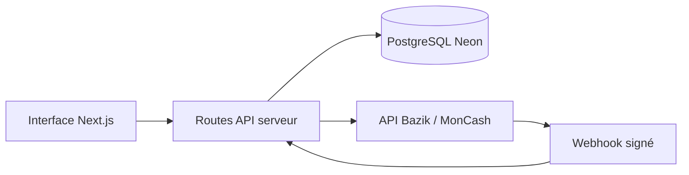

# V&V Society

Portail web pour présenter V&V Society et accompagner le parcours investisseur : formulaire, signature manuscrite, paiement MonCash et consultation du contrat.

[Voir la démonstration](https://vv-iota-taupe.vercel.app/fr) · [Configuration détaillée](docs/SETUP.md)

## Ce que le projet met en œuvre

- Interface Next.js 14, TypeScript et Tailwind CSS, avec navigation multilingue via next-intl.
- Saisie d’un dossier investisseur et signature sur canvas.
- Création des commandes MonCash côté serveur via l’API HTTP Bazik.
- Persistance PostgreSQL Neon en production ; stockage JSON disponible pour le développement local.
- Vérification HMAC des webhooks sur le corps brut, prise en compte des identifiants d’événements et revérification serveur du statut des commandes.
- Consultation et impression du contrat signé.



## Branches

`main` reste la branche par défaut. Le développement du parcours signature et paiement se poursuit sur [`fix-image`](https://github.com/ddesilias/vv-society/tree/fix-image). Consulter cette branche pour retrouver les fichiers d’intégration décrits ici ; les fonctionnalités peuvent différer entre branches.

## Démarrage local

```bash
git clone https://github.com/ddesilias/vv-society.git
cd vv-society
git switch fix-image
pnpm install
cp .env.example .env.local
pnpm dev
```

Renseigner les variables de `.env.local` selon la [documentation de configuration](docs/SETUP.md). `DATABASE_URL` est obligatoire en production. Sans les identifiants Bazik, le code utilise son mode de démonstration. Les secrets et la vérification des paiements restent côté serveur.

## Repères dans le code

| Emplacement sur `fix-image` | Responsabilité |
| --- | --- |
| `src/server/bazik.ts` | Client HTTP Bazik, cache du token et reprises sur erreurs transitoires |
| `src/server/investments.ts` | Persistance des dossiers |
| `src/app/api/bazik/webhook/route.ts` | Réception et vérification des événements de paiement |
| `src/app` | Pages, formulaires et routes API |

## État de la démonstration

La vitrine publique est consultable. Le parcours transactionnel complet, la signature d’un contrat et les paiements réels ne font pas partie de la vérification de présentation. La présence d’un webhook signé ne constitue pas à elle seule un audit de sécurité.

Les informations de licence du dépôt sont conservées dans [LICENSE](LICENSE).
